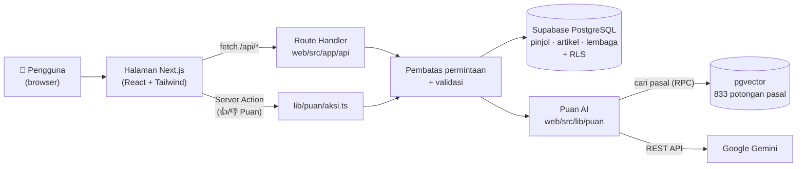

# EduPuan: Literasi Pinjol untuk Perempuan

**EduPuan** adalah platform web literasi dan edukasi finansial digital yang berfokus pada pemberdayaan perempuan agar memiliki
pengetahuan, kesadaran, dan kemampuan dalam mengambil keputusan keuangan secara bijak dan bertanggung jawab, khususnya terkait
pinjaman online (pinjol). Melalui edukasi, informasi, dan pendampingan, EduPuan membantu perempuan memahami risiko pinjol,
mengenali legalitas penyelenggara, mengetahui hak dan perlindungan hukum, serta mempertimbangkan solusi keuangan yang lebih aman
agar tidak terjebak dalam permasalahan pinjaman online.

Konten disusun untuk tiga kondisi: **mau pinjam**, **sudah terjerat**, dan **bingung mulai dari mana**. EduPuan juga dilengkapi
**Puan AI**, asisten chat yang jawabannya bersumber dari pasal peraturan resmi.

> Final project bootcamp **Perempuan Inovasi GENerasi AI**, tema *Pendidikan dan Literasi Perempuan*.

| | |
|---|---|
| 🌐 Website | _diisi saat rilis ke production_ |
| 📄 Dokumentasi API | [`web/docs/api.md`](web/docs/api.md) |
| 🗄️ ERD database | [`web/docs/erd.md`](web/docs/erd.md) |
| 🤖 Dokumentasi AI | [`web/docs/ai.md`](web/docs/ai.md) |

---

## Daftar isi

1. [Fitur](#fitur)
2. [Teknologi](#teknologi)
3. [Arsitektur sistem](#arsitektur-sistem)
4. [Fitur AI: Puan AI](#fitur-ai-puan-ai)
5. [Struktur folder](#struktur-folder)
6. [Menjalankan di komputer sendiri](#menjalankan-di-komputer-sendiri)
7. [Deployment (Vercel)](#deployment-vercel)
8. [Alur kerja GitHub](#alur-kerja-github)
9. [Tim](#tim)

---

## Fitur

| Kondisi | Halaman | Fitur |
|---|---|---|
| **Mau pinjam** | `/mau-pinjam` | Cek legalitas pinjol (data OJK), cek penawaran pinjaman, cari alternatif selain pinjol |
| **Sudah terjerat** | `/sudah-terjerat` | Hak saat ditagih, analisis pesan penagihan, rangkum utang, dokumentasi & lapor, beritahu keluarga |
| **Bingung mulai** | `/bingung-mulai` | Ceritakan situasi dengan bahasa sendiri, lalu diarahkan ke fitur dan pihak yang tepat |
| **Darurat** | `/darurat` | Nomor yang bisa langsung dihubungi saat menghadapi ancaman penagih, kekerasan, atau tekanan berat |
| **Edukasi** | `/edukasi` | Artikel literasi keuangan dan hukum pinjol |
| **Puan AI** | tombol chat di semua halaman | Tanya jawab seputar pinjol dengan sumber pasal |

## Teknologi

| Lapisan | Teknologi |
|---|---|
| Front-end & back-end | **Next.js 16** (App Router, Route Handler, Server Action), **React 19**, **TypeScript**, **Tailwind CSS v4** |
| Database | **Supabase PostgreSQL** + Row Level Security (RLS) |
| Vector database | **pgvector** (di Supabase yang sama) |
| AI | **Google Gemini**: `gemini-3.1-flash-lite` (menjawab), `gemini-embedding-001` (embedding) |
| Ekspor dokumen | jsPDF |
| Hosting | **Vercel** |

## Arsitektur sistem



- **Satu aplikasi Next.js** berisi halaman (front-end) dan API (back-end). Semuanya di-deploy sebagai satu proyek Vercel.
- **Kunci rahasia hanya di server.** Browser hanya memegang kunci *publishable* Supabase, yang dibatasi RLS sehingga hanya bisa membaca data publik.
- **Semua endpoint dibatasi** jumlah permintaannya per pengunjung. Endpoint tambah, ubah, dan hapus butuh kunci admin.
- Detail endpoint ada di [`web/docs/api.md`](web/docs/api.md). Detail 16 tabel database, relasi, normalisasi, dan 69 uji RLS ada di [`web/docs/erd.md`](web/docs/erd.md).

## Fitur AI: Puan AI

Puan AI menjawab pertanyaan seputar penagihan, bunga dan biaya, data pribadi, legalitas, dan cara melapor.
Tekniknya adalah **RAG** (*Retrieval-Augmented Generation*): sebelum menjawab, Puan **mencari** pasal yang relevan, lalu
Gemini menyusun jawaban **hanya** dari pasal-pasal tersebut dan **menyebutkan sumbernya**.

```
pesan ─► tulis ulang ke bahasa hukum ─► embedding ─► cari potongan pasal (pgvector) ─► ambil pasal utuh + rujukannya ─► Gemini menjawab + sumber
```

| Aspek | Ringkasan |
|---|---|
| **Sumber data** | 4 peraturan resmi: POJK 22/2023, POJK 40/2024, UU 27/2022 (PDP), SEOJK 19/SEOJK.06/2025. Hasilnya 248 pasal (parent) dan 833 potongan ayat/huruf (child) |
| **Model** | LLM `gemini-3.1-flash-lite` (cadangan `gemini-3.6-flash`); embedding `gemini-embedding-001` (768 dimensi) |
| **Pipeline data** | Pembersihan dan pemotongan teks di `puan-ai/` (Python) → `knowledge_base_pecah.json` → skrip `web/scripts/buat-indeks-puan.mjs` → tabel pgvector |
| **Evaluasi** | 50 soal uji. **Kena 90%** (target ≥ 85%), MRR 0,79. Model open source multilingual-e5-small juga diuji: 55%, sehingga tidak dipakai |
| **Uji bias** | 7 pasangan pertanyaan yang hanya berbeda identitas (jenis kelamin, daerah, pekerjaan, dll.). Konsistensi dasar hukum naik dari 83% menjadi **100%** setelah aturan kesetaraan ditambahkan |
| **Privasi** | Isi chat **tidak disimpan**. Yang dicatat hanya statistik anonim (topik, status) dan nilai 👍/👎 |
| **Pengaman** | Menolak pertanyaan di luar topik, mengarahkan ke kontak darurat bila ada tanda krisis, dan menampilkan keterangan bahwa pesan diproses AI (Google Gemini) serta bukan nasihat hukum final |

Penjelasan lengkap, termasuk alur, hasil evaluasi per jenis soal, dan keterbatasannya, ada di **[`web/docs/ai.md`](web/docs/ai.md)**.
Riwayat keputusan teknis ada di [`puan-ai/docs/03_keputusan_dan_hasil_uji.md`](puan-ai/docs/03_keputusan_dan_hasil_uji.md).

## Struktur folder

```
edupuan/
├── web/                         ← aplikasi Next.js (yang di-deploy ke Vercel)
│   ├── src/app/                 halaman + API (src/app/api/*)
│   ├── src/components/          komponen tampilan
│   ├── src/lib/api/             validasi, pembatas permintaan, koneksi Supabase
│   ├── src/lib/puan/            Puan AI (RAG, Gemini, prompt, Server Action)
│   ├── supabase/                file SQL database (jalankan berurutan 01 → 08)
│   ├── scripts/                 skrip laptop: isi indeks, evaluasi, uji bias
│   ├── docs/                    api.md · erd.md · ai.md
│   └── .env.example             daftar variabel lingkungan (tanpa nilai)
└── puan-ai/                     laboratorium data AI (Python): teks peraturan, knowledge base, evaluasi awal
```

## Menjalankan di komputer sendiri

### 1. Persiapan

- **Node.js 20.9 atau lebih baru** (cek dengan `node -v`) dan **Git**
- Akun **Supabase** (gratis) dan **API key Gemini** dari [Google AI Studio](https://aistudio.google.com/apikey)

### 2. Unduh kode dan pasang dependensi

```bash
git clone https://github.com/blacurly/maria-walanda-maramis.git edupuan
cd edupuan/web
npm install
```

### 3. Isi variabel lingkungan

```bash
cp .env.example .env.local
```

Lalu isi `web/.env.local`:

| Variabel | Cara memperoleh | Rahasia? |
|---|---|---|
| `NEXT_PUBLIC_SUPABASE_URL` | Supabase → Project Settings → API | Tidak |
| `NEXT_PUBLIC_SUPABASE_PUBLISHABLE_KEY` | Supabase → Project Settings → API Keys → *Publishable key* | Tidak (dibatasi RLS) |
| `SUPABASE_SECRET_KEY` | Supabase → Project Settings → API Keys → *Secret key* (`sb_secret_...`) | **Ya** |
| `GEMINI_API_KEY` | [Google AI Studio](https://aistudio.google.com/apikey) | **Ya** |
| `ADMIN_API_KEY` | Buat sendiri: `node -e "console.log(require('crypto').randomBytes(32).toString('hex'))"` | **Ya** |
| `PUAN_CATAT_STATISTIK` | Isi `1` untuk menyimpan statistik anonim dan 👍/👎. Boleh dikosongkan | Tidak |

> ⚠️ File `.env.local` **tidak pernah di-commit** (sudah ada di `.gitignore`). Anggota tim memperoleh nilai kunci bersama
> lewat chat pribadi, bukan grup atau GitHub. `ADMIN_API_KEY` dibuat masing-masing dan berbeda dengan yang di production.

### 4. Siapkan database

Di **Supabase → SQL Editor**, jalankan file di `web/supabase/` **berurutan**:

| No | File | Isi |
|---|---|---|
| 1 | `01_pinjol.sql` | Tabel pinjol |
| 2 | `02_data_pinjol.sql` | Data pinjol legal dan ilegal |
| 3 | `03_pembatas_permintaan.sql` | Pembatas permintaan |
| 4 | `04_catatan_puan.sql` | Statistik anonim Puan |
| 5 | `05_tabel_crud.sql` | Artikel, lembaga, sumber data |
| 6 | `06_seed_crud.sql` | Data awal artikel dan lembaga |
| 7 | `08_pengetahuan_puan.sql` | pgvector + tabel pengetahuan Puan |
| 8 | `07_uji_rls.sql` | Uji keamanan RLS (tidak mengubah data), semua baris harus **LULUS** |

Lalu isi pengetahuan Puan AI (pasal + embedding). Data peraturan dan vektornya sudah ada di repo, jadi kuota Gemini hampir tidak terpakai:

```bash
cd edupuan/web
node scripts/buat-indeks-puan.mjs
```

Hasil yang diharapkan: **4 dokumen, 248 pasal, 139 tautan, 833 potongan**.

### 5. Jalankan

```bash
cd edupuan/web
npm run dev
```

Buka **http://localhost:3000**.

### 6. Uji (opsional)

```bash
cd edupuan/web
npm run lint                                        # pemeriksaan kode
node scripts/evaluasi-puan.mjs                      # kualitas pencarian Puan (Kena %), tanpa kuota Gemini
npx --yes tsx@4.20.6 scripts/uji-bias-puan.ts       # uji bias (memakai kuota Gemini)
```

## Deployment (Vercel)

1. Vercel → **Add New Project** → impor repository ini.
2. **Root Directory: `web`** (framework terdeteksi otomatis sebagai Next.js).
3. **Settings → Environment Variables**: isi semua variabel dari tabel di atas untuk *Production* dan *Preview*.
   Gunakan `ADMIN_API_KEY` **yang berbeda** dari laptop.
4. **Production branch: `master`**. Branch lain otomatis mendapat *Preview deployment*.
5. Endpoint `/api/chat` memakai Node.js runtime dengan batas 60 detik (`maxDuration`), sudah diatur di kode.

## Alur kerja GitHub

```
master        ← production (yang tampil di Vercel)
  └── development   ← gabungan pekerjaan tim
        ├── feature/frontend/...
        ├── feature/backend/...
        ├── feature/ai/...
        └── feature/docs/...
```

- Setiap tugas dikerjakan di **branch turunan `development`**. Tidak ada yang langsung mengubah `master` atau `development`.
- Pekerjaan digabung lewat **pull request** dan di-merge setelah di-*review* anggota tim lain.
- Commit message memakai format **`jenis(bagian): ringkasan`**, misalnya `feat(puan): ...`, `fix(api): ...`, `docs(db): ...`.
- Rilis: PR dari `development` ke `master`.
- File `.env`, dataset besar, dan model tidak di-commit. Cara memperolehnya ada di bagian [Menjalankan](#3-isi-variabel-lingkungan).

## Tim

| Nama | Peran |
|---|---|
| Nama anggota 1 | _diisi_ |
| Nama anggota 2 | _diisi_ |
| Nama anggota 3 | _diisi_ |
| Nama anggota 4 | _diisi_ |
