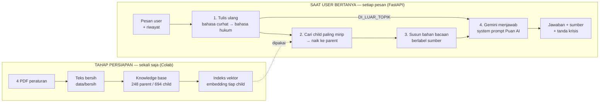
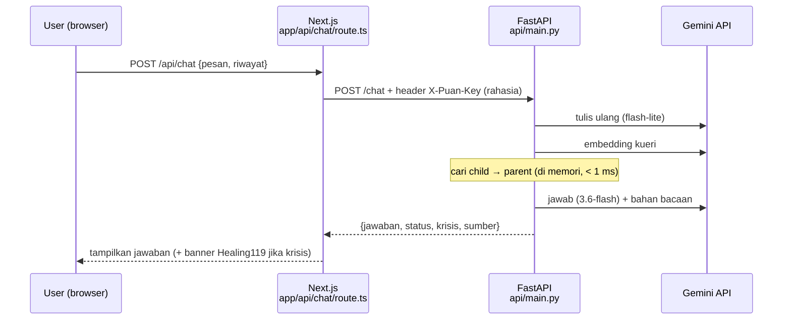

# 01 — Arsitektur & Alur Puan AI

Dokumen ini menjelaskan **bagaimana Puan AI bekerja**, dari PDF peraturan sampai jawaban yang dibaca user.
Cocok dipakai sebagai bahan belajar dan bahan slide "AI Pipeline" untuk demo day.

---

## 1. Gambaran besar: RAG

**RAG** (*Retrieval-Augmented Generation*), artinya "pembuatan jawaban yang dibantu pencarian".
Perumpamaannya **ujian open book**: Gemini tidak disuruh menjawab dari ingatannya (yang bisa salah atau kedaluwarsa),
tapi dari **halaman buku yang kita carikan dulu**. Bukunya adalah 4 peraturan resmi.

Kenapa penting untuk EduPuan: jawaban soal hak konsumen pinjol harus **bisa ditelusuri ke pasalnya**. Tanpa RAG, AI bisa
mengarang angka bunga atau nomor pasal dengan nada yakin.



---

## 2. Konsep inti: parent-child chunking

**Chunking** artinya "memotong-motong" dokumen jadi bagian kecil supaya bisa dicari.
Masalahnya: potongan **kecil** tepat untuk dicari tapi kurang konteks, sedangkan potongan **besar** lengkap tapi pencariannya kabur.
**Parent-child** mengambil keduanya:

| | Child (anak) | Parent (induk) |
|---|---|---|
| Isinya | 1 ayat / 1 huruf / 1 definisi | 1 pasal utuh (POJK/UU) atau 1 angka (SEOJK) |
| Dipakai untuk | **Mencari** (dicocokkan dengan pertanyaan) | **Menjawab** (dibaca Gemini) |
| Jumlah | 694 dicari (889 total) | 248 |

Perumpamaan dari web EduPuan sendiri: child itu seperti **kata kunci di kolom pencarian Cek Legalitas Pinjol**, kecil dan spesifik,
sedangkan parent itu **halaman detail** yang muncul setelah diklik, utuh dan lengkap.

**Contoh nyata: POJK 22/2023 Pasal 62 (etika penagihan)**

```
PARENT  POJK22:62  (seluruh pasal, dibaca Gemini)
 ├─ CHILD POJK22:62.1  (1) PUJK wajib memastikan penagihan ... sesuai dengan norma yang berlaku di masyarakat ...
 ├─ CHILD POJK22:62.2  (2) ... penagihan dilakukan: a. tidak menggunakan cara ancaman ... c. tidak kepada pihak selain Konsumen ...
 │                         f. hanya Senin–Sabtu ... pukul 08.00–20.00 ...   + Penjelasan: "terus menerus" = lebih dari 3x sehari
 ├─ CHILD POJK22:62.3  (3) Penagihan di luar tempat dan/atau waktu ... hanya dapat dilakukan atas dasar persetujuan
 │                         dan/atau perjanjian dengan Konsumen terlebih dahulu.
 └─ ayat (4)–(6) = sanksi (denda maks. Rp15 miliar): TIDAK ikut dicari, tapi tetap ada di teks parent yang dibaca Gemini
```

Pada uji langkah 12, pertanyaan *"DC nagih ke kantor dan bilang ke atasan aku, boleh gak?"* paling cocok dengan child **62.2**
(skor 0,666; uji itu belum memakai tulis ulang).
Yang dikirim ke Gemini adalah **parent 62 utuh**, jadi Gemini juga membaca ayat (3) soal syarat persetujuan.

Batas potongan mengikuti **struktur hukum** (pasal/ayat/huruf), bukan jumlah karakter. Karena itu **tidak perlu overlap**
(tumpang tindih antar-potongan): satu ayat memang satu kesatuan makna.

---

## 3. Tahap demi tahap (contoh nyata dari uji coba)

### Tahap persiapan (sekali, di Colab)

| # | Tahap | File kode | Hasil |
|---|---|---|---|
| 0 | PDF → teks bersih (buang nomor halaman, header, pisahkan penjelasan) | `puan_rag/ekstrak.py` | `data/bersih/*.txt` (**sudah jadi**) |
| 1 | Teks → parent & child, pasang rujukan & tautan | `puan_rag/knowledge_base.py`, `kurasi.py` | `output/knowledge_base.json` |
| 2 | Child → vektor (embedding) | `puan_rag/embedding.py`, `indeks.py` | `output/indeks_gemini/` |

**Embedding** artinya "mengubah teks jadi deretan angka" yang mewakili maknanya. Dua teks yang maknanya mirip punya angka yang
berdekatan, walaupun kata-katanya berbeda ("DC nagih ke atasan" ≈ "penagihan kepada pihak selain Konsumen").

### Saat user bertanya (setiap pesan, di FastAPI)

Contoh nyata dari langkah 15b (soal uji no. 12): *"aku udah komplain ke pinjolnya tapi dicuekin aja"*

**① Tulis ulang** (`chatbot.py` → `tulis_ulang`, model `gemini-3.1-flash-lite` + kamus 28 istilah)
Bahasa curhat diubah jadi bahasa hukum, karena peraturan tidak memakai kata "dicuekin", "DC", atau "galbay".
```
kueri (asli dari Gemini): "Kewajiban Penyelenggara LPBBTI dalam menindaklanjuti pengaduan Konsumen dan
                           mekanisme penyelesaian sengketa melalui Layanan Pengaduan."
```
Kalau pesannya di luar topik (resep, film), hasilnya `DI_LUAR_TOPIK` dan pencarian dilewati.

**② Cari** (`retrieval.py` → `Pencari.cari`)
Pesan asli + kueri hukum diubah jadi vektor, lalu dibandingkan dengan 694 child. Aturannya:
- ambil 8 child teratas (`k_child`) yang skornya ≥ **ambang 0,60**;
- naik ke parent-nya, maksimal **3 parent utama** (`maks_utama`);
- tambah maksimal **2 parent** dari rujukan/tautan antar-dokumen yang paling mirip (`maks_tambah`).

```
child teratas : POJK22:77.1 (0,752) "PUJK wajib memberikan Tanggapan Pengaduan..."
                POJK22:71.1 (0,736)  POJK22:70.1 (0,734)  POJK22:73.1 (0,734)  POJK22:68.1 (0,731)
parent utama  : POJK22:77, POJK22:71, POJK22:70      (tidak ada rujukan/tautan tambahan untuk pasal-pasal ini)
```
Catatan jujur: di soal uji, kunci yang ditulis adalah Pasal 74/75/82/96, sehingga soal ini tercatat MELESET, padahal Pasal 77
("wajib memberikan tanggapan") justru paling pas untuk "dicuekin". Lihat dokumen 03 soal koreksi kunci.

**③ Susun bahan bacaan** (`Pencari.susun_bahan`)
Setiap parent diberi label `[SUMBER: POJK 22/2023 Pasal 62 | lokasi]`, lengkap dengan penjelasan resminya.

**④ Gemini menjawab** (`chatbot.py` → `jawab`, model `gemini-3.6-flash`, suhu 0,4)
Gemini menerima: **system prompt Puan AI** (aturan perilaku, lihat dokumen 04) + **riwayat** 6 pesan terakhir + **pesan & bahan bacaan**.
Bahan bacaan diberi salah satu dari tiga label:

| Status | Kapan | Perilaku |
|---|---|---|
| `pasal` | ada pasal yang nyambung | jawab dari pasal, sebut sumber di baris terakhir |
| `di_luar_topik` | tulis ulang = DI_LUAR_TOPIK | jawab sopan, tidak menggiring ke pinjol |
| `tidak_ada_pasal` | topik keuangan tapi skor < ambang | akui belum tahu, arahkan ke OJK 157 / LBH / polisi |

Jika pesan mengandung kata krisis ("pengen mati", dll.), ditambahkan catatan agar Gemini menerapkan aturan **keselamatan**
(Healing119), dan respons API memuat `krisis: true` supaya web bisa menampilkan info bantuan.

---

## 4. Hubungan dengan web EduPuan



Kenapa lewat Next.js dulu, bukan browser langsung ke FastAPI? Supaya **kunci rahasia tidak pernah sampai ke browser**,
jadi kuota Gemini tidak bisa dipakai orang luar. Riwayat percakapan disimpan di **state halaman chat** (atau Supabase kalau user login);
FastAPI sendiri tidak menyimpan apa pun (*stateless*).

---

## 5. Peta file

```
puan-ai/
├─ puan_rag/                ← "mesin" Puan AI (paket Python)
│  ├─ config.py             ← semua pengaturan (ambang, jumlah pasal, model) di satu tempat
│  ├─ kurasi.py             ← KEPUTUSAN HUKUM: pasal yang diambil, tautan antar-dokumen, pola ayat sanksi
│  ├─ ekstrak.py            ← tahap 0: PDF → teks bersih
│  ├─ knowledge_base.py     ← tahap 1: teks → parent & child
│  ├─ embedding.py          ← pengubah teks → vektor (Gemini atau e5)
│  ├─ indeks.py             ← simpan/muat vektor, hanya embed yang baru
│  ├─ retrieval.py          ← tahap ②③: cari child → parent → bahan bacaan
│  ├─ prompt.py             ← instruksi tulis ulang + system prompt Puan AI
│  ├─ gemini.py             ← pembungkus Gemini: coba ulang & model cadangan saat sibuk
│  ├─ chatbot.py            ← menyatukan semua tahap: PuanAI.jawab(pesan, riwayat)
│  └─ palsu.py              ← komponen tiruan untuk uji tanpa API key
├─ scripts/                 ← perintah yang dijalankan manusia
│  ├─ bangun_kb.py · buat_indeks.py · tanya.py
│  ├─ evaluasi.py           ← skor pencarian 50 soal (Kena, MRR, lintas dokumen, kalibrasi ambang)
│  └─ uji_jawaban.py        ← jawaban lengkap ke Excel untuk dinilai manusia
├─ api/main.py              ← layanan FastAPI untuk web
├─ notebooks/puan_ai_pipeline.ipynb  ← menjalankan semuanya di Colab, dengan penjelasan
├─ data/
│  ├─ bersih/               ← teks peraturan siap pakai (UU PDP = versi koreksi manual)
│  ├─ mentah/               ← 4 PDF asli
│  ├─ kamus_istilah.json    ← 28 istilah santai → hukum
│  └─ referensi/            ← daftar kurasi pasal, koreksi UU PDP, 50 soal uji
├─ output/                  ← hasil buatan script (knowledge base, indeks, hasil evaluasi)
├─ supabase/schema.sql      ← opsional: skema pgvector kalau nanti pindah ke Supabase
├─ tests/test_puan.py       ← 7 uji otomatis tanpa API key
└─ docs/                    ← dokumen ini dan 3 lainnya
```
