# ERD Database EduPuan

Diagram hubungan antartabel (Entity Relationship Diagram) database EduPuan di Supabase (PostgreSQL).
Semua SQL ada di [`web/supabase/`](../supabase/).

## Diagram

```mermaid
erDiagram
    sumber_data ||--o{ pinjol : "sumber"
    kategori_artikel ||--o{ artikel : "mengelompokkan"
    artikel ||--o{ rujukan_artikel : "punya"
    jenis_lembaga ||--o{ lembaga : "mengelompokkan"
    lembaga ||--o{ lembaga_situasi : "dirujuk"
    situasi_darurat ||--o{ lembaga_situasi : "merujuk"
    dokumen_hukum ||--o{ pasal : "memuat"
    pasal ||--o{ potongan_pasal : "dipotong menjadi"
    pasal ||--o{ pasal_tautan : "merujuk (asal)"
    pasal ||--o{ pasal_tautan : "dirujuk (tujuan)"

    sumber_data {
        bigint id PK
        text nama UK "not null"
        text penerbit "not null"
        text tautan "https:// atau kosong"
        timestamptz dibuat_pada
        timestamptz diubah_pada
    }
    pinjol {
        bigint id PK
        text nama "not null"
        text nama_perusahaan
        text status "legal | ilegal"
        text alamat
        bigint sumber_id FK "not null, on delete restrict"
        text sumber "lama, dihapus di tugas 3"
        date diperbarui_pada "tanggal data resmi"
        timestamptz dibuat_pada
        timestamptz diubah_pada
    }
    kategori_artikel {
        smallint id PK
        text kode UK "not null, format slug"
        text label "not null"
        smallint urutan
    }
    artikel {
        bigint id PK
        text slug UK "not null, format slug"
        text judul "not null"
        text ringkasan "not null"
        smallint kategori_id FK "not null, on delete restrict"
        text bentuk "artikel | panduan"
        smallint menit_baca "1 sampai 60"
        text gambar_url
        jsonb isi "array bagian"
        text catatan
        text fitur_label "berpasangan dengan fitur_tautan"
        text fitur_tautan
        timestamptz diterbitkan_pada "kosong = draf"
        timestamptz dibuat_pada
        timestamptz diubah_pada
    }
    rujukan_artikel {
        bigint id PK
        bigint artikel_id FK "not null, on delete cascade"
        text jenis "dasar_hukum | sumber"
        text teks "not null"
        text tautan
        smallint urutan
    }
    jenis_lembaga {
        smallint id PK
        text kode UK "not null"
        text label "not null"
    }
    lembaga {
        bigint id PK
        text nama UK "not null"
        text penyelenggara
        smallint jenis_lembaga_id FK "not null, on delete restrict"
        text kanal "telepon | whatsapp | situs"
        text nomor "not null"
        text tautan "tel: atau https://"
        boolean aktif
        timestamptz dibuat_pada
        timestamptz diubah_pada
    }
    situasi_darurat {
        smallint id PK
        text kode UK "not null"
        text ikon
        text pilihan "not null"
        text judul "not null"
        text info "not null"
        smallint urutan
        boolean aktif
        timestamptz dibuat_pada
        timestamptz diubah_pada
    }
    lembaga_situasi {
        smallint situasi_id PK,FK "on delete cascade"
        bigint lembaga_id PK,FK "on delete cascade"
        smallint urutan
        text label_khusus
    }
    statistik_puan {
        bigint id PK
        timestamptz dibuat "not null"
        text topik "not null"
        text situasi "not null"
        text status "4 nilai"
        boolean krisis
        integer durasi_ms ">= 0"
    }
    umpan_balik_puan {
        bigint id PK
        timestamptz dibuat "not null"
        smallint nilai "1 | -1"
        text topik "not null"
        text situasi "not null"
        text status "4 nilai"
    }
    pembatas_permintaan {
        text kunci PK "hash IP + endpoint"
        timestamptz jendela_mulai PK
        integer jumlah ">= 0"
    }
    dokumen_hukum {
        smallint id PK
        text kode UK "mis. POJK22"
        text judul UK "mis. POJK 22/2023"
        timestamptz dibuat_pada
        timestamptz diubah_pada
    }
    pasal {
        text id PK "mis. POJK22:62"
        smallint dokumen_id FK "not null, on delete restrict"
        text label "mis. POJK 22/2023 Pasal 62"
        text lokasi "BAB / Bagian"
        text teks "isi pasal utuh (parent)"
        text penjelasan "penjelasan resmi"
        timestamptz dibuat_pada
        timestamptz diubah_pada
    }
    pasal_tautan {
        text pasal_id PK,FK "on delete cascade"
        text tujuan_id PK,FK "on delete cascade"
        text jenis "rujukan | terkait"
    }
    potongan_pasal {
        text id PK "mis. POJK22:62.2.c"
        text pasal_id FK "not null, on delete cascade"
        text jenis "isi | definisi | contoh_perhitungan"
        text header
        text teks "potongan kecil (child)"
        text penjelasan
        text sidik "hash teks, 16 hex"
        text model "gemini-embedding-001"
        vector embedding "768 angka"
        timestamptz dibuat_pada
        timestamptz diubah_pada
    }
```

Keterangan simbol: `||--o{` = satu ke banyak (satu baris di kiri bisa punya nol atau banyak baris di kanan).
PK = primary key, FK = foreign key, UK = unique.

## Kelompok tabel

| Kelompok | Tabel | Dipakai untuk |
|---|---|---|
| Data pinjol | `pinjol`, `sumber_data` | Cek Legalitas, Rangkum Utang, Dokumentasi & Lapor |
| Artikel edukasi | `kategori_artikel`, `artikel`, `rujukan_artikel` | Halaman Edukasi |
| Bantuan darurat | `jenis_lembaga`, `lembaga`, `situasi_darurat`, `lembaga_situasi` | Halaman Darurat |
| Catatan Puan AI | `statistik_puan`, `umpan_balik_puan` | Rekap anonim & evaluasi chatbot |
| Keamanan API | `pembatas_permintaan` | Pembatas permintaan (rate limit) |
| **Pengetahuan Puan AI (vector database)** | `dokumen_hukum`, `pasal`, `pasal_tautan`, `potongan_pasal` | RAG Puan AI: pasal dicari lewat kemiripan vektor (pgvector) |

Tabel catatan Puan dan pembatas sengaja **tidak berelasi** dengan tabel lain: isinya anonim dan tidak menyimpan identitas pengguna.

### Data AI: pengetahuan Puan (parent-child)

| Tabel | Isi | Jumlah |
|---|---|---|
| `dokumen_hukum` | Peraturan sumber: POJK 22/2023, POJK 40/2024, SEOJK 19/2025, UU 27/2022 (PDP) | 4 |
| `pasal` | **Parent**: satu pasal / angka utuh, teks yang dibaca Gemini saat menjawab | 248 |
| `potongan_pasal` | **Child**: ayat / huruf kecil yang **dicari**, beserta embedding 768 angka | 833 |
| `pasal_tautan` | Pasal yang saling merujuk (dalam dokumen) atau terkait (antar-dokumen) | 139 |

Alurnya: pertanyaan → embedding → fungsi SQL `cari_pasal_puan` mencari potongan paling mirip
→ mengambil pasal induknya (maks. 3) + pasal tautannya (maks. 2) → teks pasal dikirim ke Gemini.
Isi tabel dibuat oleh `web/scripts/buat-indeks-puan.mjs` dari `puan-ai/output/knowledge_base_pecah.json`.
Penjelasan model, metrik, dan hasil uji: [`ai.md`](ai.md).

## Normalisasi

| Sebelum | Sesudah | Alasan |
|---|---|---|
| Teks sumber diketik ulang di 524 baris `pinjol` | Tabel `sumber_data` (2 baris) + FK `pinjol.sumber_id` | Mengubah judul sumber cukup di 1 baris |
| Label topik ditulis di setiap artikel | Tabel `kategori_artikel` + FK `artikel.kategori_id` | Label kategori hanya ditulis sekali |
| Daftar dasar hukum & sumber di dalam objek artikel | Tabel `rujukan_artikel` (1 baris per rujukan) | Daftar yang panjangnya berubah-ubah dipisah jadi tabel |
| Kontak darurat ditulis ulang di setiap situasi | `lembaga` + tabel penghubung `lembaga_situasi` | Hubungan banyak-ke-banyak: satu kontak dipakai di banyak situasi |
| Teks pasal utuh disalin ke setiap potongan (versi file JSON) | `pasal` (parent) + `potongan_pasal` (child) dengan FK `pasal_id` | Teks pasal hanya disimpan sekali; potongan hanya menyimpan bagian kecilnya |
| Daftar rujukan disimpan sebagai array di dalam pasal | Tabel penghubung `pasal_tautan` | Hubungan banyak-ke-banyak antarbaris di tabel yang sama |

Pengecualian yang disengaja: `artikel.isi` disimpan sebagai `jsonb` karena isi artikel bertingkat (bagian → paragraf/daftar) dan selalu dibaca utuh.

## Aturan hapus (ON DELETE)

| Hubungan | Aturan | Artinya |
|---|---|---|
| `sumber_data` → `pinjol` | RESTRICT | Sumber tidak bisa dihapus selama masih dipakai pinjol |
| `kategori_artikel` → `artikel` | RESTRICT | Kategori tidak bisa dihapus selama masih berisi artikel |
| `jenis_lembaga` → `lembaga` | RESTRICT | Jenis tidak bisa dihapus selama masih dipakai lembaga |
| `artikel` → `rujukan_artikel` | CASCADE | Artikel dihapus, rujukannya ikut terhapus |
| `lembaga` / `situasi_darurat` → `lembaga_situasi` | CASCADE | Lembaga atau situasi dihapus, pasangannya ikut terhapus |
| `dokumen_hukum` → `pasal` | RESTRICT | Dokumen tidak bisa dihapus selama masih memuat pasal |
| `pasal` → `potongan_pasal` | CASCADE | Pasal dihapus, potongan dan embedding-nya ikut terhapus |
| `pasal` → `pasal_tautan` (asal dan tujuan) | CASCADE | Pasal dihapus, tautan dari/ke pasal itu ikut terhapus |

## Keamanan (Row Level Security)

| Tabel | Pengunjung anonim (browser) | Server (secret key) |
|---|---|---|
| `pinjol`, `sumber_data`, `kategori_artikel`, `jenis_lembaga` | Baca semua | Baca & tulis |
| `artikel`, `rujukan_artikel` | Baca yang sudah terbit saja | Baca & tulis |
| `lembaga`, `situasi_darurat`, `lembaga_situasi` | Baca yang aktif saja | Baca & tulis |
| `statistik_puan`, `umpan_balik_puan`, `pembatas_permintaan` | Tidak bisa apa pun | Baca & tulis |
| `dokumen_hukum`, `pasal`, `pasal_tautan`, `potongan_pasal` | Baca semua (isi peraturan adalah dokumen publik) | Baca & tulis (skrip pembuat indeks) |

Tidak ada policy tulis untuk anonim. Fungsi pencarian `cari_potongan` dan `cari_pasal_puan` boleh dipanggil anonim karena hanya membaca
(`security invoker`, jadi tetap tunduk pada RLS). Bukti uji: [`07_uji_rls.sql`](../supabase/07_uji_rls.sql) → **69 lulus, 0 gagal**
(16 tabel × baca/tambah/ubah/hapus, fungsi pembatas, artikel draf/terjadwal dan lembaga nonaktif tersembunyi, fungsi pencarian Puan).

## Urutan menjalankan SQL (setup baru)

| No | File | Isi |
|---|---|---|
| 1 | `01_pinjol.sql` | Tabel `pinjol` |
| 2 | `02_data_pinjol.sql` | 94 pinjol legal + 430 ilegal |
| 3 | `03_pembatas_permintaan.sql` | Tabel & fungsi pembatas permintaan |
| 4 | `04_catatan_puan.sql` | Tabel catatan Puan AI |
| 5 | `05_tabel_crud.sql` | Tabel artikel, lembaga, sumber data |
| 6 | `06_seed_crud.sql` | Data awal artikel & lembaga |
| 7 | `07_uji_rls.sql` | Uji keamanan (tidak mengubah data). Jalankan lagi setelah langkah 8 |
| 8 | `08_pengetahuan_puan.sql` | pgvector + 4 tabel pengetahuan Puan + fungsi pencarian |
| 9 | `node scripts/buat-indeks-puan.mjs` (dari folder `web`) | Mengisi tabel pengetahuan Puan (pasal + embedding) |