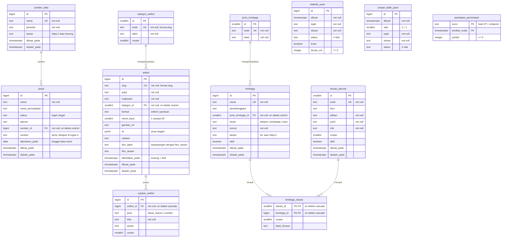

# ERD Database EduPuan

Diagram hubungan antartabel (Entity Relationship Diagram) database EduPuan di Supabase (PostgreSQL).
Semua SQL ada di [`web/supabase/`](../supabase/).

## Diagram

Keterangan simbol: `||--o{` = satu ke banyak (satu baris di kiri bisa punya nol atau banyak baris di kanan).
PK = primary key, FK = foreign key, UK = unique.

## Kelompok tabel

| Kelompok | Tabel | Dipakai untuk |
|---|---|---|
| Data pinjol | `pinjol`, `sumber_data` | Cek Legalitas, Rangkum Utang, Dokumentasi & Lapor |
| Artikel edukasi | `kategori_artikel`, `artikel`, `rujukan_artikel` | Halaman Edukasi |
| Bantuan darurat | `jenis_lembaga`, `lembaga`, `situasi_darurat`, `lembaga_situasi` | Halaman Darurat |
| Catatan Puan AI | `statistik_puan`, `umpan_balik_puan` | Rekap anonim & evaluasi chatbot |
| Keamanan API | `pembatas_permintaan` | Pembatas permintaan (rate limit) |

Tabel catatan Puan dan pembatas sengaja **tidak berelasi** dengan tabel lain: isinya anonim dan tidak menyimpan identitas pengguna.

## Normalisasi

| Sebelum | Sesudah | Alasan |
|---|---|---|
| Teks sumber diketik ulang di 524 baris `pinjol` | Tabel `sumber_data` (2 baris) + FK `pinjol.sumber_id` | Mengubah judul sumber cukup di 1 baris |
| Label topik ditulis di setiap artikel | Tabel `kategori_artikel` + FK `artikel.kategori_id` | Label kategori hanya ditulis sekali |
| Daftar dasar hukum & sumber di dalam objek artikel | Tabel `rujukan_artikel` (1 baris per rujukan) | Daftar yang panjangnya berubah-ubah dipisah jadi tabel |
| Kontak darurat ditulis ulang di setiap situasi | `lembaga` + tabel penghubung `lembaga_situasi` | Hubungan banyak-ke-banyak: satu kontak dipakai di banyak situasi |

Pengecualian yang disengaja: `artikel.isi` disimpan sebagai `jsonb` karena isi artikel bertingkat (bagian → paragraf/daftar) dan selalu dibaca utuh.

## Aturan hapus (ON DELETE)

| Hubungan | Aturan | Artinya |
|---|---|---|
| `sumber_data` → `pinjol` | RESTRICT | Sumber tidak bisa dihapus selama masih dipakai pinjol |
| `kategori_artikel` → `artikel` | RESTRICT | Kategori tidak bisa dihapus selama masih berisi artikel |
| `jenis_lembaga` → `lembaga` | RESTRICT | Jenis tidak bisa dihapus selama masih dipakai lembaga |
| `artikel` → `rujukan_artikel` | CASCADE | Artikel dihapus, rujukannya ikut terhapus |
| `lembaga` / `situasi_darurat` → `lembaga_situasi` | CASCADE | Lembaga atau situasi dihapus, pasangannya ikut terhapus |

## Keamanan (Row Level Security)

| Tabel | Pengunjung anonim (browser) | Server (secret key) |
|---|---|---|
| `pinjol`, `sumber_data`, `kategori_artikel`, `jenis_lembaga` | Baca semua | Baca & tulis |
| `artikel`, `rujukan_artikel` | Baca yang sudah terbit saja | Baca & tulis |
| `lembaga`, `situasi_darurat`, `lembaga_situasi` | Baca yang aktif saja | Baca & tulis |
| `statistik_puan`, `umpan_balik_puan`, `pembatas_permintaan` | Tidak bisa apa pun | Baca & tulis |

Tidak ada policy tulis untuk anonim. Bukti uji: [`07_uji_rls.sql`](../supabase/07_uji_rls.sql) → **49 lulus, 0 gagal**.

## Urutan menjalankan SQL (setup baru)

| No | File | Isi |
|---|---|---|
| 1 | `01_pinjol.sql` | Tabel `pinjol` |
| 2 | `02_data_pinjol.sql` | 94 pinjol legal + 430 ilegal |
| 3 | `03_pembatas_permintaan.sql` | Tabel & fungsi pembatas permintaan |
| 4 | `04_catatan_puan.sql` | Tabel catatan Puan AI |
| 5 | `05_tabel_crud.sql` | Tabel artikel, lembaga, sumber data |
| 6 | `06_seed_crud.sql` | Data awal artikel & lembaga |
| 7 | `07_uji_rls.sql` | Uji keamanan (tidak mengubah data) |